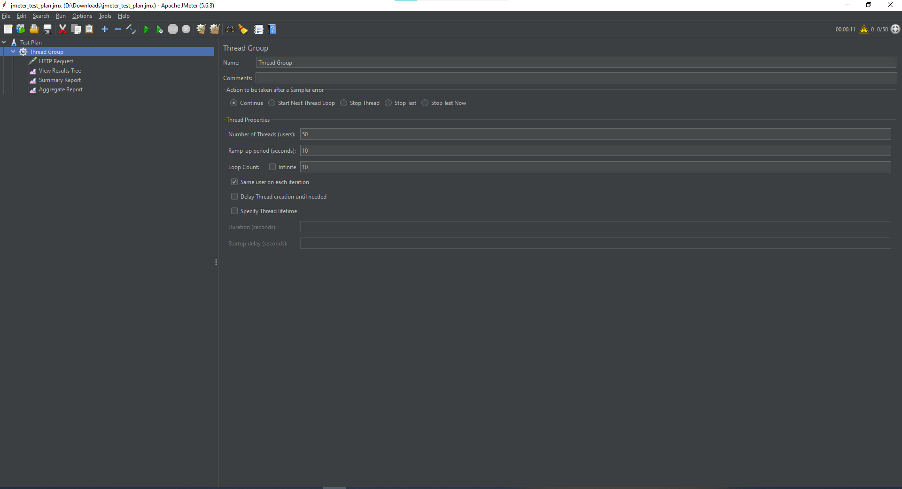
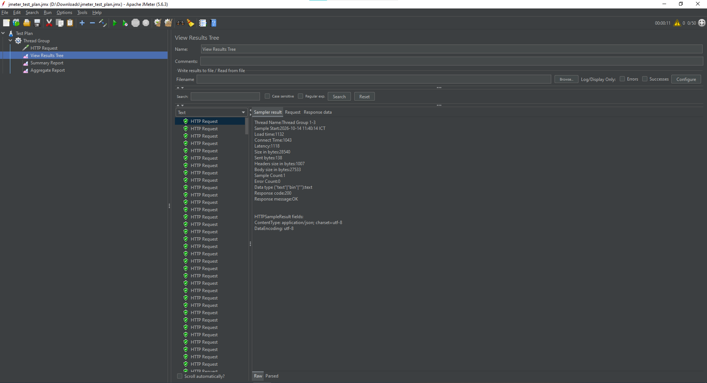
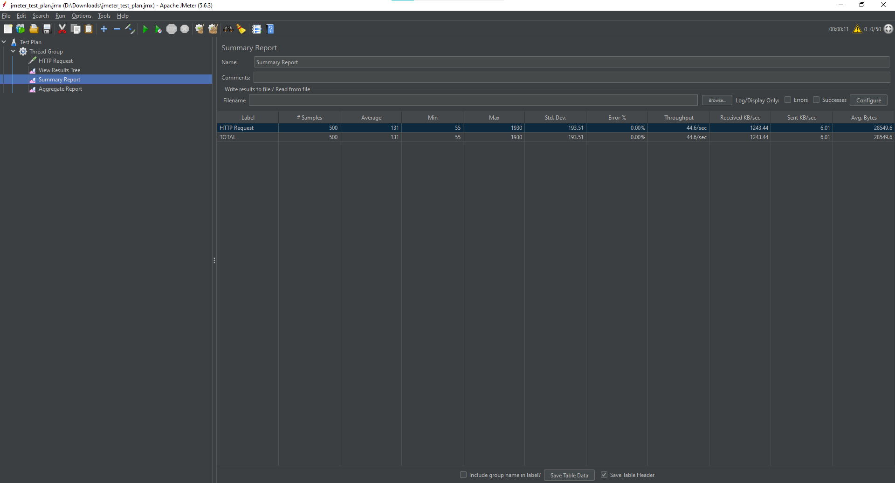
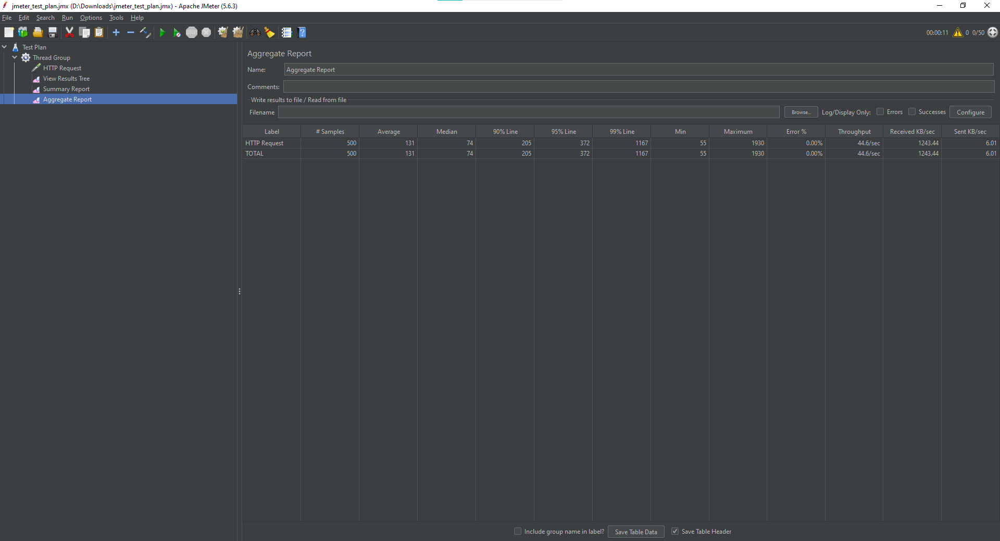

# Báo cáo Bài tập Kiểm thử Hiệu năng với Apache JMeter

## 1. Giới thiệu
- **Môn học / Nội dung:** Kiểm thử phần mềm (Software Testing)
- **Công cụ sử dụng:** Apache JMeter
- **Mục tiêu:** Xây dựng Test Plan, thực hiện kiểm thử tải (Load Testing) đối với API mẫu và phân tích kết quả hiệu năng hệ thống.

---

## 2. Cấu hình Kịch bản Kiểm thử (Test Plan Configuration)
Kịch bản được thiết lập để kiểm tra khả năng chịu tải của API công khai với các thông số sau:
- **Target Endpoint:** `https://jsonplaceholder.typicode.com/posts`
- **HTTP Method:** `GET`
- **Number of Users (Threads):** 50 concurrent users
- **Ramp-up Period:** 10 giây
- **Loop Count:** 10 lặp
- **Tổng số Request:** 500 requests

*Hình ảnh minh họa cấu hình Thread Group:*
>  

---

## 3. Các bước thực hiện trên JMeter
1. Khởi động Apache JMeter và tạo mới **Test Plan**.
2. Thêm **Thread Group** và cấu hình các thông số số lượng người dùng giả lập.
3. Thêm **HTTP Request** trỏ đến endpoint cần kiểm tra.
4. Thêm các **Listeners** (*View Results Tree*, *Summary Report*, *Aggregate Report*) để ghi nhận kết quả.
5. Nhấn nút **Start (Play)** để chạy kịch bản kiểm thử.

---

## 4. Kết quả thực hiện và Phân tích

### 4.1. View Results Tree
Hiển thị trạng thái chi tiết của các request (đều trả về mã `200 OK`, đảm bảo hệ thống phản hồi chính xác).
> 

### 4.2. Summary Report
Bảng tổng hợp kết quả chạy thực tế:
- **Samples:** 500 requests
- **Average:** Thời gian phản hồi trung bình (ms)
- **Error %:** Tỷ lệ lỗi (`0.00%`)
- **Throughput:** Tốc độ xử lý (requests/sec)
> 

### 4.3. Aggregate Report
Phân tích chi tiết độ trễ và các mức phân vị (Median, 90% Line, 95% Line, 99% Line):
> 

---

## 5. Kết luận
- Hệ thống xử lý ổn định dưới mức tải 50 người dùng đồng thời.
- Tỷ lệ lỗi bằng 0%, thời gian đáp ứng nằm trong giới hạn cho phép.
- Đã hoàn thành việc xây dựng kịch bản `.jmx`, chạy kiểm thử thực tế và trực quan hóa kết quả bằng báo cáo chi tiết.
